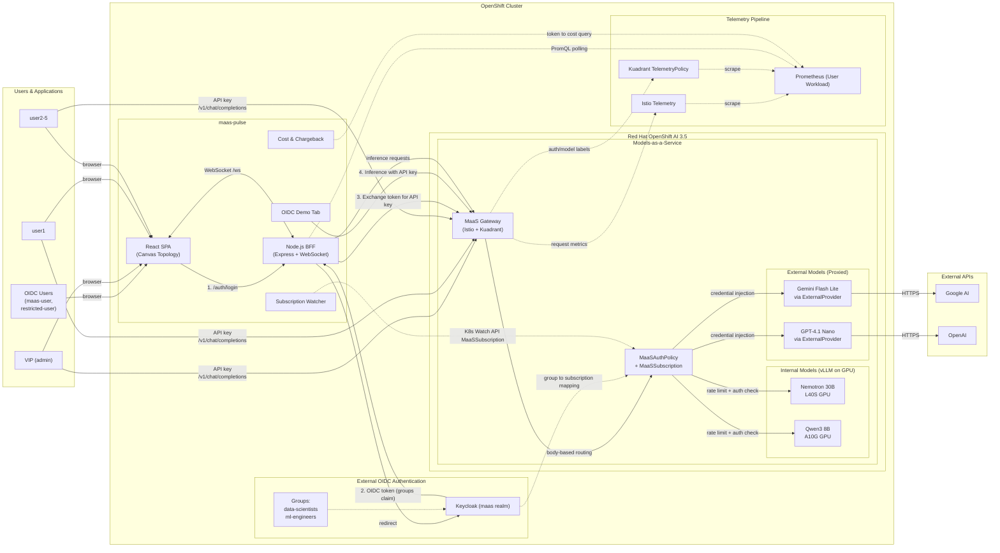
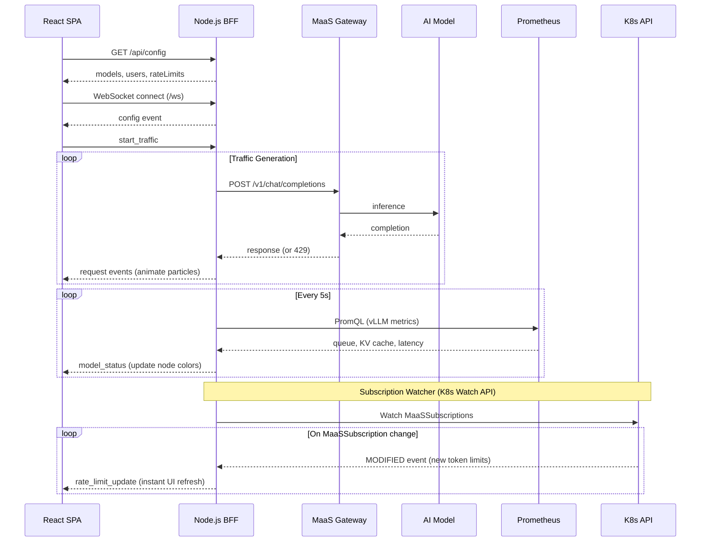
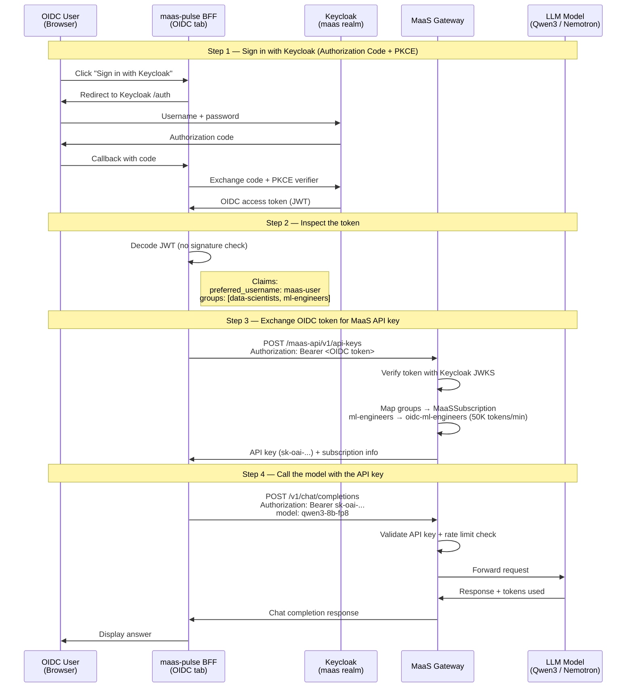

# Real-time AI traffic observability with MaaS on OpenShift AI

Visualize and monitor live inference traffic across multiple AI models served through Red Hat OpenShift AI Models-as-a-Service.

## Table of Contents

- [Overview](#overview)
- [Detailed description](#detailed-description)
  - [See it in action](#see-it-in-action)
  - [Architecture diagrams](#architecture-diagrams)
  - [Cost and Chargeback](#cost-and-chargeback)
  - [OIDC Authentication](#oidc-authentication)
- [Requirements](#requirements)
  - [Minimum hardware requirements](#minimum-hardware-requirements)
  - [Minimum software requirements](#minimum-software-requirements)
  - [Required user permissions](#required-user-permissions)
- [Deploy](#deploy)
  - [Prerequisites](#prerequisites)
  - [Installation](#installation)
  - [Validating the deployment](#validating-the-deployment)
  - [Delete](#delete)
- [Repository structure](#repository-structure)
- [References](#references)
- [Technical details](#technical-details)
- [Tags](#tags)

## Overview

maas-pulse deploys a multi-model MaaS environment on OpenShift AI 3.5 with built-in observability. It provisions internal models (served via vLLM with GPU acceleration) and external model proxies (e.g., Google Gemini) behind a unified MaaS gateway, then exports per-subscription metrics to enable real-time traffic visualization and usage attribution.

## Detailed description

Organizations adopting AI need visibility into how their models are being consumed: which teams use which models, how much capacity is being utilized, and where latency bottlenecks occur. maas-pulse addresses this by combining OpenShift AI's Models-as-a-Service infrastructure with a telemetry pipeline that captures per-user, per-model, and per-subscription metrics.

The deployment includes two internal models (NVIDIA Nemotron 3 Nano 30B and Qwen3-8B) served via vLLM on dedicated GPUs, plus external models (Google Gemini 3.1 Flash Lite and OpenAI GPT-4.1 Nano) proxied through the MaaS inference gateway with automatic credential injection. Multi-tenant access control is managed through MaaSSubscription and MaaSAuthPolicy resources, with Keycloak providing user authentication via OpenShift OAuth.

Istio Telemetry and Kuadrant TelemetryPolicy capture request-level metrics (latency, model, user, subscription, organization) and export them to Prometheus. A Grafana instance (deployed separately) can query these metrics to build dashboards for usage attribution, cost center tracking, and performance monitoring.

A custom web UI (maas-pulse Traffic UI) provides real-time traffic flow visualization: a canvas-rendered topology shows users, the MaaS gateway, and models as an animated network graph, with colored particles representing live inference requests flowing through the system. The UI displays per-user rate limits (dynamically updated via K8s Watch on MaaSSubscription CRs), rate-limit blocking status, and per-model health metrics (queue depth, KV cache utilization, p95 latency) — all updated in real-time via WebSocket. Rate limit changes made in the RHOAI console are reflected in the UI within seconds, without requiring a page refresh or redeployment.

### See it in action

> **WIP**: Screenshots and a walkthrough video will be added soon. The traffic UI is deployed and functional — see [Architecture diagrams](#architecture-diagrams) below for how it works.

### Architecture diagrams

**System architecture** — shows how users, the MaaS gateway, internal/external models, telemetry pipeline, OIDC authentication, and the traffic UI fit together:



> Source: [`docs/images/architecture.mmd`](docs/images/architecture.mmd)

**Traffic UI data flow** — shows the real-time request lifecycle from browser control to model inference and back:



> Source: [`docs/images/traffic-ui-flow.mmd`](docs/images/traffic-ui-flow.mmd)

### Cost and Chargeback

The **Cost & Chargeback** tab provides real-time usage attribution and cost estimation across all models and users. It queries Prometheus for three key metrics:

- **`authorized_hits`** — token consumption per user per model (input + output tokens)
- **`authorized_calls`** — total request count per user per subscription
- **`limited_calls`** — rate-limited (429) requests

Token counts are converted to dollar estimates using configurable per-model rates (editable in the UI). The dashboard shows:

| View | Details |
|---|---|
| Overview cards | Total cost, total tokens, total requests, rate-limited count |
| Cost by User | Per-user cost breakdown with percentage share bars |
| Cost by Model | Per-model cost with input/output rate hints |
| Pricing Config | Editable input/output rates per model ($/1M tokens) |
| Detailed Breakdown | Sortable table of every user x model combination |

Time range selector: 1h, 6h, 24h, 7d, All Time. Auto-refreshes every 30 seconds.

**API endpoints:**
- `GET /api/chargeback?range=1h|6h|24h|7d|all` — returns current cost data
- `PUT /api/chargeback/rates` — update per-model pricing (`{ model, inputPer1M, outputPer1M }`)

### OIDC Authentication

maas-pulse supports external OIDC authentication via Keycloak, enabling group-based access control with per-group rate limits. This is an alternative to admin-issued API keys — users authenticate with Keycloak and exchange their OIDC token for a MaaS API key.

The **OIDC tab** in the maas-pulse UI provides a built-in 4-step demo flow: sign in with Keycloak, inspect the JWT token claims, exchange for a MaaS API key, and call a model — all without leaving the browser. A "Burst 15 requests" button demonstrates rate limiting in action. A standalone Python demo app (`demo/oidc/maas-ui.py`) is also available for local testing.

**OIDC flow** (4 steps):



> Source: [`docs/images/oidc-flow.mmd`](docs/images/oidc-flow.mmd)

**What gets deployed:**

| Resource | Purpose |
|---|---|
| `KeycloakRealmImport` | Creates `maas` realm with users, groups, and `maas-oidc` client |
| `MaaSAuthPolicy` (per group) | Grants OIDC group access to specified models |
| `MaaSSubscription` (per group) | Sets per-group token rate limits |
| `Job` (patch-aitenant-oidc) | Patches AITenant with OIDC issuer URL and client ID |

**Default groups and rate limits:**

| Group | Priority | Token limit |
|---|---|---|
| `data-scientists` | 30 | 1K-2K tokens/min per model |
| `ml-engineers` | 40 | 50K-100K tokens/min per model |

**Enable via Helm:**
```bash
helm upgrade <release> charts/maas-pulse \
  --set oidc.enabled=true \
  --set trafficUI.enabled=true
```

The issuer URL is auto-derived from `global.wildcardDomain` (`https://keycloak.<domain>/realms/maas`). Override with `--set oidc.issuerUrl=...` only if Keycloak uses a custom hostname. The OIDC tab in the UI is automatically enabled when both flags are set.

**Standalone demo app** (alternative, runs locally):
```bash
python3 demo/oidc/maas-ui.py \
  --from-cluster \
  --model-served 'publishers/llm/models/qwen3-8b-fp8' \
  --model-path 'qwen3-8b-fp8' \
  --port 8090
```

For manual OIDC setup without Helm, use `scripts/setup-oidc.sh`.

## Requirements

### Minimum hardware requirements

**Internal models (GPU required):**

| Model | GPU | CPU | Memory |
|---|---|---|---|
| NVIDIA Nemotron 3 Nano 30B A3B FP8 | 1x NVIDIA L40S | 2 (req) / 4 (limit) | 16Gi (req) / 24Gi (limit) |
| Qwen3-8B FP8 Dynamic | 1x NVIDIA A10G | 2 (req) / 4 (limit) | 12Gi (req) / 20Gi (limit) |

**Platform components** (no GPU required):
- MaaS gateway, Keycloak, PostgreSQL, monitoring stack: ~4 vCPU, ~8Gi memory total
- Persistent storage: ~50Gi (Prometheus retention + Grafana + PostgreSQL)

> **Note**: If using only external models (e.g., Gemini), no GPU is required.

#### Both GPU types are mandatory for the internal models

The two internal models are pinned to specific accelerators with `nodeSelector`
(`nvidia.com/gpu.product: NVIDIA-L40S` and `NVIDIA-A10G`), so a cluster with only one of
them leaves the other model permanently `Pending`. The reference cluster uses AWS
`g6e.2xlarge` for the L40S and `g5.4xlarge` for the A10G. To run on different hardware,
change `nodeSelector` under `models` in `charts/maas-pulse/values.yaml`.

There is **no CPU or simulator fallback** today, so the project cannot be tried without
GPUs. That is a known gap.

Allow **two** A10G nodes rather than one if you want to demonstrate autoscaling: Qwen3
scales to a second replica and needs somewhere to put it.

#### FP8 on A10G works, despite advice to the contrary

Other Red Hat MaaS material warns against running FP8 models on `g5` / A10G, on the
grounds that FP8 needs compute capability >= 8.0. A10G is Ampere at 8.6, so it clears
that bar; what it lacks is *native* FP8 hardware, which Ada and Hopper have. vLLM falls
back to Marlin kernels, and `qwen3-8b-fp8` has run on A10G throughout this project.
Treat the warning as being about peak throughput, not about whether it runs.

#### GPU node taints and tolerations

GPU nodes carry `nvidia.com/gpu=:NoSchedule` so that ordinary workloads do not land on
expensive hardware. Every model pod in this chart declares the matching toleration
(`tolerations` per model in `values.yaml`), so the taint is optional from the models'
point of view — removing it costs money and noisy neighbours, not availability.

The taint belongs in the MachineSet, at `spec.template.spec.taints`, not applied by hand
to running nodes. Applied by hand it is lost every time the nodes are recreated, which
on this project happens daily; see `docs/reference/gpu-machineset-taint.yaml` for the
patch and the reasoning.

#### First start is slow

The modelcar and vLLM images come to roughly 25 GB per model. On a freshly created node
expect **5-10 minutes** from pod scheduling to a model answering requests, most of it
image pull. A pod sitting in `Init` during that window is normal.

### Minimum software requirements

- OpenShift Container Platform 4.19+
- Red Hat OpenShift AI 3.5 (operator `rhods-operator.3.5.0`)
- Helm CLI 3.12+
- `oc` CLI 4.14+

The following operators are installed automatically by the `dependency-operators` chart:
- Red Hat OpenShift AI (RHOAI 3.5)
- Red Hat Connectivity Link (RHCL / Kuadrant)
- cert-manager Operator
- LeaderWorkerSet Operator
- CloudNativePG
- Red Hat Build of Keycloak (RHBK)
- Cluster Observability Operator
- Red Hat OpenTelemetry

### Required user permissions

Cluster admin access is required because this deployment:
- Installs cluster-scoped operators (RHOAI, Kuadrant, cert-manager)
- Creates a DataScienceCluster and Gateway resources
- Configures cluster monitoring (user-workload monitoring)
- Creates cross-namespace resources (Keycloak OAuth integration)

## Deploy

### Prerequisites

Before deploying, ensure you have:
- Access to a Red Hat OpenShift cluster with the requirements above
- `oc` CLI installed and authenticated as cluster admin (`oc whoami` should return an admin user)
- `helm` CLI (3.12+) installed
- A default StorageClass configured on the cluster
- (Optional) A Google Gemini API key and/or OpenAI API key for external models

### Installation

**Option A: All-in-one script (recommended)**

The `all-in-one.sh` script handles environment detection, operator installation, and chart deployment:

```bash
git clone https://github.com/YOUR_ORG/maas-pulse.git
cd maas-pulse
./all-in-one.sh
```

The script will:
1. Detect your cluster's ingress domain and certificate configuration
2. Prompt for admin and user passwords (stored in `.env`, gitignored)
3. Prompt for an optional Google Gemini API key (if provided, deploys the external model; if skipped, only internal models are deployed)
4. Install all dependency operators and wait for RHOAI to be ready
5. Deploy the maas-pulse chart with Keycloak, monitoring, and models
6. Wire the traffic UI's per-user MaaS API keys, if it finds them in `user_keys.json` or in `USER_API_KEYS` in `.env` (both gitignored)

**Option B: Step-by-step with Helm**

1. Install dependency operators:
```bash
helm upgrade --install dependency-operators charts/dependency-operators \
  -f environment.yaml
oc wait --for=condition=Ready datasciencecluster default-dsc --timeout 15m0s
```

2. Deploy the maas-pulse chart:
```bash
helm upgrade --install maas-pulse charts/maas-pulse \
  -n default --timeout 20m0s \
  -f charts/maas-pulse/all-dependencies.yaml \
  -f environment.yaml \
  --set keycloak.realm.admin.password="YOUR_ADMIN_PASSWORD" \
  --set keycloak.realm.user.password="YOUR_USER_PASSWORD"
```

To include external models with real API keys:
```bash
  --set externalModels[0].apiKey="YOUR_GEMINI_API_KEY" \
  --set externalModels[1].apiKey="YOUR_OPENAI_API_KEY"
```

To deploy the traffic UI with per-user MaaS API keys (issued from Gen AI Studio), pass
them in the same order as `trafficUI.userNames`, escaping the separating commas:
```bash
  --set trafficUI.enabled=true \
  --set-string trafficUI.apiKeys="sk-oai-admin\,sk-oai-user1\,sk-oai-user2"
```
The chart creates the `maas-pulse-ui-apikeys` Secret from this value, so no secret has to
be created by hand. If you would rather manage that Secret yourself, leave
`trafficUI.apiKeys` empty and point `trafficUI.apiKeysSecret` at it instead.

Prometheus access needs no secret at all: the UI queries Thanos with the service account
token mounted in its own pod, which the chart binds to `cluster-monitoring-view`.

### Validating the deployment

1. Check all models are registered and ready:
```bash
oc get llminferenceservice -n llm
oc get maasmodelref -n llm
```
All entries should show `READY: True` or `PHASE: Ready`.

2. Verify the MaaS gateway is accessible:
```bash
MAAS_URL=$(oc get maasmodelref -n llm -o jsonpath='{.items[0].status.endpoint}' | sed 's|/llm/.*||')
echo $MAAS_URL
```

3. Test model inference (requires a MaaS API key from the Gen AI Studio dashboard):
```bash
curl -s "$MAAS_URL/v1/chat/completions" \
  -H "Authorization: Bearer YOUR_MAAS_API_KEY" \
  -H "Content-Type: application/json" \
  -d '{"model": "qwen3-8b-fp8", "messages": [{"role": "user", "content": "Say hello in one word."}], "max_tokens": 10}'
```

### Delete

To completely remove the deployment:

1. Uninstall the maas-pulse chart:
```bash
helm uninstall maas-pulse -n default
```

2. (Optional) Uninstall dependency operators:
```bash
helm uninstall dependency-operators
```

3. (Optional) Delete the model namespace and related resources:
```bash
oc delete namespace llm
```

> **Note**: Uninstalling the dependency-operators chart does not remove the operators themselves (OLM subscriptions persist). To fully remove operators, delete the subscriptions and CSVs manually.

## Running the demo

Governance and elasticity need opposite request sizes and cannot be shown well in the
same run. Do them as two segments — which also tells a cleaner story: first who is
allowed how much, then what happens when that is not enough.

### Segment 1 — tiers and rate limiting

| Setting | Value |
|---|---|
| Prompt | Short |
| Rate | 3/s |
| Users | all |

The Free tier hits its 1k/min ceiling about **16 seconds** in and its three nodes turn
red together, which is the point: the limit belongs to the subscription, not the person.
Pro follows later, Max never does. Over 90 seconds the throughput ladder is plain —
roughly 40, 100 and 256 successful requests for Free, Pro and Max.

While traffic runs, change the Free tier's token limit in the RHOAI dashboard under
**Settings → MaaS governance**. The UI picks it up live through a Kubernetes watch, and
the whole Free cohort moves at once.

### Segment 2 — KV pressure and autoscaling

| Setting | Value |
|---|---|
| Prompt | Unique prefix, ~1500 tokens |
| Rate | **1/s** |
| Users | Max tier only (user7-9) |

KV cache crosses 80% at around **40 seconds** and the queue climbs gently — 0, then 8,
then 25 — at which point the autoscaler adds a replica. The new pod takes 5-10 minutes
to pull images and load, so start this segment early if you want the second replica on
screen.

Max tier only, because a 1500-token prompt exceeds the Free tier's entire 1000/min
allowance in a single request; the others would simply sit at 429 and show nothing.

**Rate matters more than it looks.** The constraint is token throughput, and one A10G
running Qwen3 saturates a little below 1/s at this prompt size. At 2/s the queue reaches
343 and climbs; at 4/s with 4000-token prompts it reaches 461 and essentially everything
times out at the client's 30s deadline. That is not a fault, it is a queue growing faster
than it drains, and it looks like a broken system rather than a busy one. Trading length
for frequency does not help either: 750 tokens at 2/s moves the same tokens per second
but queues faster, because each request carries its own fixed scheduling cost.

### Showing cache-aware routing

Set the prompt shape to **Shared prefix** with two or more replicas running. Every
request then carries an identical preamble, so the prefix cache hits and the endpoint
picker concentrates traffic on whichever replica is already warm. Switch to **Unique
prefix** and that advantage disappears — the same hardware, the same load, only the
cacheability of the prompt has changed.

## Development

```bash
cd app
npm ci
npm test     # type-checks the server including its tests, then runs them
npm run build
```

`npm test` covers the model-name normalization in `server/src/model-names.ts`. One model
is spelled differently by every system that reports it — `publishers/llm/models/qwen3-8b-fp8`
from the MaaS API, `qwen3-8b-fp8` from vLLM metrics, `llm/qwen3-8b-fp8-kserve-route` from
Kuadrant, `gemini-3.1-flash-lite` vs `gemini-3-1-flash-lite` for external models,
`gpt-4.1-nano-2025-04-14` from OpenAI — and anything that joins those sources has to fold
them together first. The test fixtures are real label values read off the cluster.

GitHub Actions runs the same commands on every push and pull request, plus a
`--platform linux/amd64` image build (an arm64 image from an Apple Silicon laptop starts
nowhere on the cluster) and a Helm lint and render.

## Repository structure

```
.
├── all-in-one.sh                          # End-to-end deployment script
├── environment.yaml.tpl                   # Cluster-specific values template
├── app/                                   # maas-pulse Traffic UI application
│   ├── client/                            #   React SPA (Vite + Canvas topology)
│   │   └── src/components/
│   │       ├── ChargebackView.tsx          #   Cost & Chargeback dashboard
│   │       ├── OidcView.tsx               #   OIDC 4-step demo tab
│   │       └── ...                        #   Traffic topology, controls, etc.
│   └── server/                            #   Node.js BFF (Express + WebSocket + K8s Watch)
│       └── src/
│           ├── chargeback.ts              #   Prometheus → cost conversion logic
│           ├── model-names.ts             #   Canonical model name across all sources
│           ├── model-names.test.ts        #   Tests, fixtures taken from the cluster
│           ├── oidc.ts                    #   OIDC login, token exchange, chat proxy
│           ├── prometheus.ts              #   PromQL query helper
│           └── index.ts                   #   Express app + WebSocket + API routes
├── charts/
│   ├── dependency-operators/              # Helm chart: operators + operands
│   │   ├── charts/install-operators/      #   Sub-chart for OLM subscriptions
│   │   ├── files/                         #   Scripts for DSC, Kuadrant, LWS creation
│   │   └── values.yaml                    #   Operator channels, versions, namespaces
│   └── maas-pulse/                        # Helm chart: models + auth + telemetry
│       ├── charts/keycloak/               #   Sub-chart for Keycloak + OAuth
│       ├── templates/models/              #   LLMInferenceService, ExternalProvider,
│       │                                  #   ExternalModel, MaaSModelRef, etc.
│       ├── templates/oidc/                #   OIDC authentication resources
│       │   ├── keycloak-realm-import.yaml #     Keycloak realm with users + groups
│       │   ├── auth-policies.yaml         #     MaaSAuthPolicy per OIDC group
│       │   ├── subscriptions.yaml         #     MaaSSubscription per group
│       │   └── job-patch-aitenant-oidc.yaml #   Post-install AITenant OIDC patch
│       ├── templates/telemetry*.yaml      #   Istio + Kuadrant telemetry config
│       ├── all-dependencies.yaml          #   Enables Keycloak, monitoring, Kuadrant
│       └── values.yaml                    #   Models, subscriptions, rate limits, OIDC
├── demo/
│   └── oidc/
│       └── maas-ui.py                     # Standalone OIDC demo app (4-step flow)
├── docs/
│   ├── examples/grafana.yaml              # Grafana deployment with OAuth + Prometheus
│   ├── images/                            # Architecture diagrams (Mermaid)
│   │   ├── architecture.mmd              #   System architecture diagram
│   │   ├── traffic-ui-flow.mmd           #   Traffic UI sequence diagram
│   │   └── oidc-flow.mmd                 #   OIDC authentication flow diagram
│   └── reference/test-model-access.yaml   # Standalone model endpoint test pod
├── scripts/
│   ├── setup-oidc.sh                      # Standalone OIDC setup (no Helm required)
│   └── realm-import-standalone.yaml       # Portable Keycloak realm definition
└── README.md
```

## References

- [Red Hat OpenShift AI 3.5 Documentation](https://docs.redhat.com/en/documentation/red_hat_openshift_ai_self-managed/3.5)
- [RHOAI 3.5 Release Notes](https://docs.redhat.com/en/documentation/red_hat_openshift_ai_self-managed/3.5/html-single/release_notes/index)
- [RHOAI Supported Configurations](https://access.redhat.com/articles/rhoai-supported-configs-3.x)
- [Automating RHOAI installations with Helm and GitOps](https://developers.redhat.com/articles/2026/08/26/automating-red-hat-openshift-ai-installations-with-helm-and-gitops)

## Technical details

### Models-as-a-Service architecture

MaaS provides an OpenAI-compatible API gateway for model inference:
- **Endpoint**: `/v1/chat/completions` with body-based model routing (`"model"` field selects the target)
- **Auth**: `Authorization: Bearer sk-oai-...` (API keys issued via Gen AI Studio or REST API)
- **Internal models**: Served via vLLM with modelcar-format OCI images, registered through `MaaSModelRef`
- **External models**: Proxied through `ExternalProvider` + `ExternalModel` CRs (`inference.opendatahub.io/v1alpha1`) with automatic credential injection

### Telemetry pipeline

- **Istio Telemetry** (`telemetry.yaml`): Captures `REQUEST_DURATION` with subscription label from `x-maas-subscription` header
- **Kuadrant TelemetryPolicy** (`telemetrypolicy.yaml`): Extracts model name from response body, user/subscription/org from auth identity
- **Prometheus**: Metrics scraped via user-workload monitoring, queryable through Thanos Querier
- **Grafana** (`docs/examples/grafana.yaml`): Example deployment with OAuth proxy and Prometheus datasource

### vLLM configuration

| Model | Parser | Max context | GPU | Node selector |
|---|---|---|---|---|
| Nemotron 3 Nano 30B | `qwen3_coder` + custom reasoning parser | 131072 | L40S | `nvidia.com/gpu.product: NVIDIA-L40S` |
| Qwen3-8B | `hermes` | 40960 | A10G | `nvidia.com/gpu.product: NVIDIA-A10G` |

Both models use GPU taints (`nvidia.com/gpu=:NoSchedule`) to isolate inference workloads.

### Known operational notes

- **GPU deadlock on updates**: With `RollingUpdate` strategy and a single GPU, new pods cannot schedule until the old pod is manually deleted to release the GPU.
- **External model TLS**: If `maas.opendatahub.io/tls` annotation is set to `false` while a `credentialRef` exists, provider API keys are sent in plain text.

## Tags

**Title:** Real-time AI traffic observability with MaaS on OpenShift AI
**Description:** Visualize and monitor live inference traffic across multiple AI models served through Red Hat OpenShift AI Models-as-a-Service
**Industry:** Cross-industry
**Product:** OpenShift AI
**Use case:** Observability, AI operations
**Partner:** N/A
**Contributor org:** Red Hat
