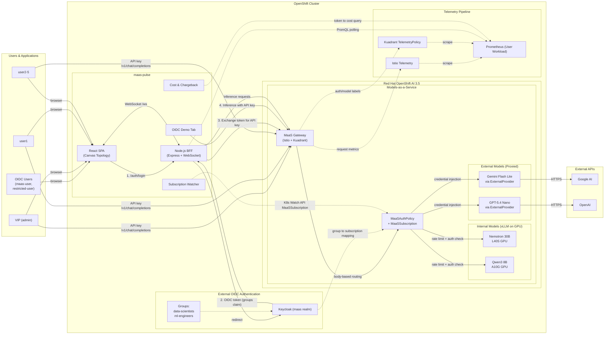
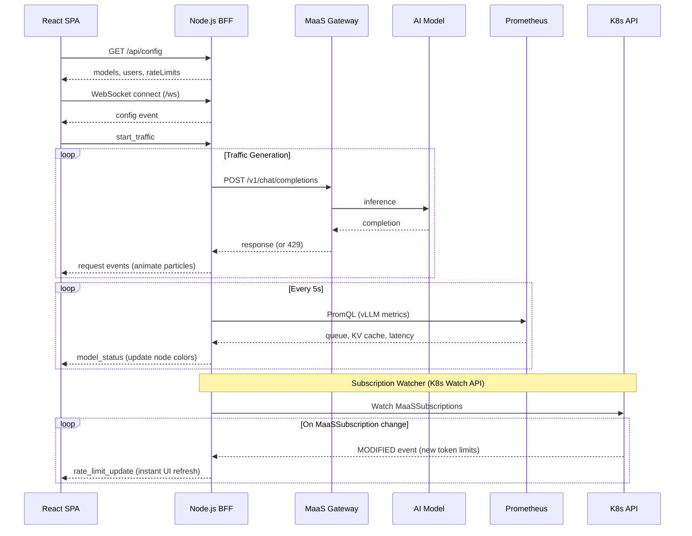
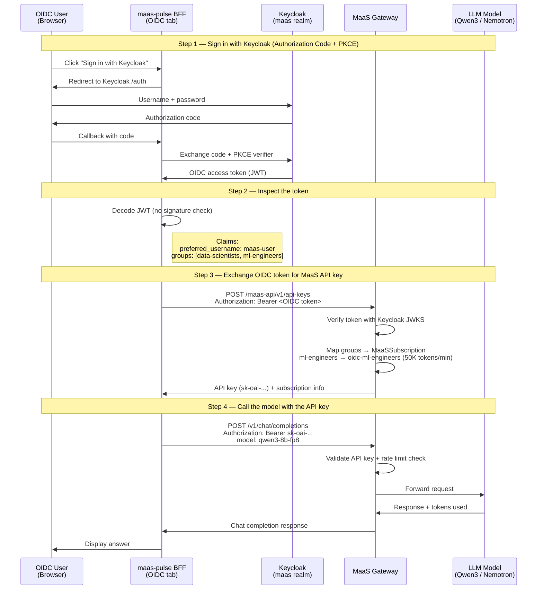

# Real-time AI traffic observability with MaaS on OpenShift AI

Visualize and monitor live inference traffic across multiple AI models served through Red Hat OpenShift AI Models-as-a-Service.

## Table of Contents

- [Overview](#overview)
- [Detailed description](#detailed-description)
  - [See it in action](#see-it-in-action)
  - [Architecture diagrams](#architecture-diagrams)
  - [Cost and Chargeback](#cost-and-chargeback)
  - [OIDC Authentication](#oidc-authentication)
- [Requirements](#requirements)
  - [Minimum hardware requirements](#minimum-hardware-requirements)
  - [Minimum software requirements](#minimum-software-requirements)
  - [Required user permissions](#required-user-permissions)
- [Deploy](#deploy)
  - [Prerequisites](#prerequisites)
  - [Installation](#installation)
  - [Validating the deployment](#validating-the-deployment)
  - [Delete](#delete)
- [Repository structure](#repository-structure)
- [References](#references)
- [Technical details](#technical-details)
- [Tags](#tags)

## Overview

maas-pulse deploys a multi-model MaaS environment on OpenShift AI 3.5 with built-in observability. It provisions internal models (served via vLLM with GPU acceleration) and external model proxies (e.g., Google Gemini) behind a unified MaaS gateway, then exports per-subscription metrics to enable real-time traffic visualization and usage attribution.

## Detailed description

Organizations adopting AI need visibility into how their models are being consumed: which teams use which models, how much capacity is being utilized, and where latency bottlenecks occur. maas-pulse addresses this by combining OpenShift AI's Models-as-a-Service infrastructure with a telemetry pipeline that captures per-user, per-model, and per-subscription metrics.

The deployment includes two internal models (NVIDIA Nemotron 3 Nano 30B and Qwen3-8B) served via vLLM on dedicated GPUs, plus external models (Google Gemini 3.1 Flash Lite and OpenAI GPT-5.4 Nano) proxied through the MaaS inference gateway with automatic credential injection. Multi-tenant access control is managed through MaaSSubscription and MaaSAuthPolicy resources, with Keycloak providing user authentication via OpenShift OAuth.

Istio Telemetry and Kuadrant TelemetryPolicy capture request-level metrics (latency, model, user, subscription, organization) and export them to Prometheus. A Grafana instance (deployed separately) can query these metrics to build dashboards for usage attribution, cost center tracking, and performance monitoring.

A custom web UI (maas-pulse Traffic UI) provides real-time traffic flow visualization: a canvas-rendered topology shows users, the MaaS gateway, and models as an animated network graph, with colored particles representing live inference requests flowing through the system. The UI displays per-user rate limits (dynamically updated via K8s Watch on MaaSSubscription CRs), rate-limit blocking status, and per-model health metrics (queue depth, KV cache utilization, p95 latency) — all updated in real-time via WebSocket. Rate limit changes made in the RHOAI console are reflected in the UI within seconds, without requiring a page refresh or redeployment.

Each replica gets its own box, with two bars and a speed line beneath it. The upper bar is the work that replica is holding: the requests in its continuous batch, with any backlog stacked on in red. The lower bar is its prefix cache hit rate over the last two minutes — a replica that has served nothing recently draws an empty track rather than claiming a cold cache. Together these make a scale-up legible: two boxes the same colour, one cache bar full and one empty, is the endpoint picker warming a new replica. Each bar carries a small caption naming what it measures and its exact reading (`In flight (of 50) · 11 running`, `Cache hit rate · 45%`), so an audience does not have to be told what the strips mean. The speed line under them comes from vLLM's own histograms over the last 30 seconds: on the left the average time to first token (queueing and prompt reading both count, cache hits cut it), on the right the answer tokens per second the replica produces across its whole batch. Measured on Qwen3 with one user sending 2,000-token prompts: 0.43 s to first token when every prompt is new, 0.06 s when they share a cached document. Under short-prompt load one A10G produced about 900–1,400 tokens/s while each answer ran at about 49 tokens/s.

The gateway is drawn as the policy pipeline every request passes through: **Authenticate** (API key, ServiceAccount token or OIDC), **Subscription** (which tier, which models), **Token limits** (tokens per minute per user), **Route by model** (llm-d for internal models, the provider's key injected for external ones) and **Meter usage** (what feeds Cost & Chargeback). A stage lights up as it acts, and the ones that can refuse a request count their refusals. A request the gateway turns away bounces back from it as a crossed red dot.

Users are grouped by subscription tier, and each tier has its own colour family (Free teal, Pro blue, Max violet), so a request's dot says which tier sent it; red, amber and green are kept for state. Each tier shows its per-user limits once, because every member shares them (models on our GPUs in the left column, external ones in the right), and each user row names the models that user is currently paused on: in red when MaaS refused (the tier's token limit), in amber when the provider behind an external model refused it with its own rate limit, which is a 429 from upstream and not a MaaS limit.

The model column is split the same way MaaS is: **Self-hosted models** (AI Inference on OpenShift AI) and **Cloud-hosted APIs** (via the MaaS gateway). A dashed boundary marks **your OpenShift cluster**, around the gateway and the self-hosted models, with the cloud-hosted APIs left outside: prompts to your own models stay inside it, and where the lines to an external API cross it a marker says "prompt leaves your network" (it lights up as a request crosses, and in a trace). Requests for a model on our cluster pass through **llm-d**, the inference scheduler, drawn between the gateway and the replicas it chooses between; it glows as it routes, and clicking it opens its scoreboard: the four things it weighs, with the weights the chart gives them, then for each model what every replica looks like to it right now (queue, KV cache, cache hit rate), the share of traffic each replica won, and one line saying why. External models do not go through it. Every model is a dark card whose border and small label carry its state (healthy, busy, overloaded), so the card that changes is the one that stands out. Each internal card is labelled as the vLLM server it is (`vLLM · KV cache 23%`). Every answer is traced to the replica that served it (the gateway adds `x-maas-upstream`) and to how much of its prompt came from vLLM's prefix cache (`cached_tokens`): the live feed says so per request, and a returning dot ringed in light blue was answered mostly from cache. Clicking a bar's caption, a model box or one of the gateway's steps opens a short plain-language explanation with the live reading: what "in flight" and continuous batching mean, what a cache hit saves and why a new replica starts low, what one replica is (one vLLM server on one GPU, with room in its KV cache for so many tokens), and what each gateway step checks. A line under the traffic controls says what the chosen pattern and prompt shape will send. Text is drawn larger than usual for projectors, and on a short screen (a 720p projector) the whole view scales down to fit rather than cutting anything off. When the autoscaler adds or removes a replica, a notice under the topology says why: each condition it checks, the reading, the limit, and which one fired. It stays until dismissed, while the new replica's box counts how long it has been starting.

**Trace a request** walks one real request down the stack. Pick who asks which model (and, if you like, type the question live), and the BFF sends it for real, then replays its trip step by step while the rest of the view dims: the user, the gateway's three checks (who is calling, may they use this model, are they within their token budget), llm-d's choice of replica (the one the gateway reports really served it), vLLM's work (how many prompt tokens came from the prefix cache, how many were computed, how long it took), metering, and the answer. The presenter moves on with Next (or →, space), back with Back (←), out with Close (Esc); the caption sits at the top of the sidebar so it never covers the part it describes. A request the gateway refuses stops at the step that refused it (a Free user over budget stops at token limits with a 429), and an external model skips llm-d and our GPUs and leaves the cluster.

External models have no replica metrics, so they are drawn in indigo with their provider's mark (OpenAI, Google) instead of a health colour. Users appear under the same short names everywhere (`free:user1`, `pro:user4`, `max:user7`, `admin`): in the topology, the live feed, the Cost & Chargeback view, and RHOAI's own observability dashboard. The chart's TelemetryPolicy shortens the ServiceAccount identity `system:serviceaccount:maas-tier-free:user1` to that form in the metrics themselves.

### See it in action

> **WIP**: Screenshots and a walkthrough video will be added soon. The traffic UI is deployed and functional — see [Architecture diagrams](#architecture-diagrams) below for how it works.

### Architecture diagrams

**System architecture** — shows how users, the MaaS gateway, internal/external models, telemetry pipeline, OIDC authentication, and the traffic UI fit together:



> Source: [`docs/images/architecture.mmd`](docs/images/architecture.mmd)

**Traffic UI data flow** — shows the real-time request lifecycle from browser control to model inference and back:



> Source: [`docs/images/traffic-ui-flow.mmd`](docs/images/traffic-ui-flow.mmd)

### Cost and Chargeback

The **Cost & Chargeback** tab provides real-time usage attribution and cost estimation across all models and users. It queries Prometheus for three key metrics:

- **`authorized_hits`** — token consumption per user per model (input + output tokens)
- **`authorized_calls`** — total request count per user per subscription
- **`limited_calls`** — rate-limited (429) requests

Token counts are converted to dollar estimates using configurable per-model rates (editable in the UI). The dashboard shows:

| View | Details |
|---|---|
| Overview cards | Total cost, total tokens, total requests, rate-limited count |
| Cost by User | Per-user cost breakdown with percentage share bars |
| Cost by Model | Per-model cost with input/output rate hints |
| Pricing Config | Editable input/output rates per model ($/1M tokens) |
| Detailed Breakdown | Sortable table of every user x model combination |

Time range selector: 1h, 6h, 24h, 7d, All Time. Auto-refreshes every 30 seconds.

**API endpoints:**
- `GET /api/chargeback?range=1h|6h|24h|7d|all` — returns current cost data
- `PUT /api/chargeback/rates` — update per-model pricing (`{ model, inputPer1M, outputPer1M }`)

### OIDC Authentication

maas-pulse supports external OIDC authentication via Keycloak, enabling group-based access control with per-group rate limits. This is an alternative to admin-issued API keys — users authenticate with Keycloak and exchange their OIDC token for a MaaS API key.

The **OIDC tab** in the maas-pulse UI provides a built-in 4-step demo flow: sign in with Keycloak, inspect the JWT token claims, exchange for a MaaS API key, and call a model — all without leaving the browser. A "Burst 15 requests" button demonstrates rate limiting in action. A standalone Python demo app (`demo/oidc/maas-ui.py`) is also available for local testing.

**OIDC flow** (4 steps):



> Source: [`docs/images/oidc-flow.mmd`](docs/images/oidc-flow.mmd)

**What gets deployed:**

| Resource | Purpose |
|---|---|
| `KeycloakRealmImport` | Creates `maas` realm with users, groups, and `maas-oidc` client |
| `MaaSAuthPolicy` (per group) | Grants OIDC group access to specified models |
| `MaaSSubscription` (per group) | Sets per-group token rate limits |
| `Job` (patch-aitenant-oidc) | Patches AITenant with OIDC issuer URL and client ID |

**Default groups and rate limits:**

| Group | Priority | Token limit |
|---|---|---|
| `data-scientists` | 30 | 1K-2K tokens/min per model |
| `ml-engineers` | 40 | 50K-100K tokens/min per model |

**Enable via Helm:**
```bash
helm upgrade <release> charts/maas-pulse \
  --set oidc.enabled=true \
  --set trafficUI.enabled=true
```

The issuer URL is auto-derived from `global.wildcardDomain` (`https://keycloak.<domain>/realms/maas`). Override with `--set oidc.issuerUrl=...` only if Keycloak uses a custom hostname. The OIDC tab in the UI is automatically enabled when both flags are set.

**Standalone demo app** (alternative, runs locally):
```bash
python3 demo/oidc/maas-ui.py \
  --from-cluster \
  --model-served 'publishers/llm/models/qwen3-8b-fp8' \
  --model-path 'qwen3-8b-fp8' \
  --port 8090
```

For manual OIDC setup without Helm, use `scripts/setup-oidc.sh`.

## Requirements

### Minimum hardware requirements

**Internal models (GPU required):**

| Model | GPU | CPU | Memory |
|---|---|---|---|
| NVIDIA Nemotron 3 Nano 30B A3B FP8 | 1x NVIDIA L40S | 2 (req) / 4 (limit) | 16Gi (req) / 24Gi (limit) |
| Qwen3-8B FP8 Dynamic | 1x NVIDIA A10G | 2 (req) / 4 (limit) | 12Gi (req) / 20Gi (limit) |

**Platform components** (no GPU required):
- MaaS gateway, Keycloak, PostgreSQL, monitoring stack: ~4 vCPU, ~8Gi memory total
- Persistent storage: ~50Gi (Prometheus retention + Grafana + PostgreSQL)

> **Note**: If using only external models (e.g., Gemini), no GPU is required.

#### Both GPU types are mandatory for the internal models

The two internal models are pinned to specific accelerators with `nodeSelector`
(`nvidia.com/gpu.product: NVIDIA-L40S` and `NVIDIA-A10G`), so a cluster with only one of
them leaves the other model permanently `Pending`. The reference cluster uses AWS
`g6e.2xlarge` for the L40S and `g5.4xlarge` for the A10G. To run on different hardware,
change `nodeSelector` under `models` in `charts/maas-pulse/values.yaml`.

There is **no CPU or simulator fallback** today, so the project cannot be tried without
GPUs. That is a known gap.

Allow **two** A10G nodes rather than one if you want to demonstrate autoscaling: Qwen3
scales to a second replica and needs somewhere to put it. That spare A10G is the only
extra GPU the demo ever uses (see "Only Qwen3 scales" below).

#### FP8 on A10G works, despite advice to the contrary

Other Red Hat MaaS material warns against running FP8 models on `g5` / A10G, on the
grounds that FP8 needs compute capability >= 8.0. A10G is Ampere at 8.6, so it clears
that bar; what it lacks is *native* FP8 hardware, which Ada and Hopper have. vLLM falls
back to Marlin kernels, and `qwen3-8b-fp8` has run on A10G throughout this project.
Treat the warning as being about peak throughput, not about whether it runs.

#### GPU node taints and tolerations

GPU nodes carry `nvidia.com/gpu=:NoSchedule` so that ordinary workloads do not land on
expensive hardware. Every model pod in this chart declares the matching toleration
(`tolerations` per model in `values.yaml`), so the taint is optional from the models'
point of view — removing it costs money and noisy neighbours, not availability.

The taint belongs in the MachineSet, at `spec.template.spec.taints`, not applied by hand
to running nodes. Applied by hand it is lost every time the nodes are recreated, which
on this project happens daily; see `docs/reference/gpu-machineset-taint.yaml` for the
patch and the reasoning.

#### First start is slow

The modelcar and vLLM images come to roughly 25 GB per model. On a freshly created node
expect **5-10 minutes** from pod scheduling to a model answering requests, most of it
image pull. A pod sitting in `Init` during that window is normal.

### Minimum software requirements

- OpenShift Container Platform 4.19+
- Red Hat OpenShift AI 3.5 (operator `rhods-operator.3.5.2`) and Red Hat Connectivity Link 1.4.4 (channel `stable-1.4`)
- Helm CLI 3.12+
- `oc` CLI 4.14+

The following operators are installed automatically by the `dependency-operators` chart:
- Red Hat OpenShift AI (RHOAI 3.5)
- Red Hat Connectivity Link (RHCL / Kuadrant)
- cert-manager Operator
- LeaderWorkerSet Operator
- CloudNativePG
- Red Hat Build of Keycloak (RHBK)
- Cluster Observability Operator
- Red Hat OpenTelemetry

### Required user permissions

Cluster admin access is required because this deployment:
- Installs cluster-scoped operators (RHOAI, Kuadrant, cert-manager)
- Creates a DataScienceCluster and Gateway resources
- Configures cluster monitoring (user-workload monitoring)
- Creates cross-namespace resources (Keycloak OAuth integration)

## Deploy

### Prerequisites

Before deploying, ensure you have:
- Access to a Red Hat OpenShift cluster with the requirements above
- `oc` CLI installed and authenticated as cluster admin (`oc whoami` should return an admin user)
- `helm` CLI (3.12+) installed
- A default StorageClass configured on the cluster
- (Optional) A Google Gemini API key and/or OpenAI API key for external models

### Installation

**Option A: All-in-one script (recommended)**

The `all-in-one.sh` script handles environment detection, operator installation, and chart deployment:

```bash
git clone https://github.com/YOUR_ORG/maas-pulse.git
cd maas-pulse
./all-in-one.sh
```

The script will:
1. Detect your cluster's ingress domain and certificate configuration
2. Prompt for admin and user passwords (stored in `.env`, gitignored)
3. Prompt for an optional Google Gemini API key (if provided, deploys the external model; if skipped, only internal models are deployed)
4. Install all dependency operators and wait for RHOAI to be ready
5. Deploy the maas-pulse chart with Keycloak, monitoring, and models
6. Wire the traffic UI's per-user MaaS API keys, if it finds them in `user_keys.json` or in `USER_API_KEYS` in `.env` (both gitignored)

**Option B: Step-by-step with Helm**

1. Install dependency operators:
```bash
helm upgrade --install dependency-operators charts/dependency-operators \
  -f environment.yaml
oc wait --for=condition=Ready datasciencecluster default-dsc --timeout 15m0s
```

2. Deploy the maas-pulse chart:
```bash
helm upgrade --install maas-pulse charts/maas-pulse \
  -n default --timeout 20m0s \
  -f charts/maas-pulse/all-dependencies.yaml \
  -f environment.yaml \
  --set keycloak.realm.admin.password="YOUR_ADMIN_PASSWORD" \
  --set keycloak.realm.user.password="YOUR_USER_PASSWORD"
```

To include external models with real API keys:
```bash
  --set externalModels[0].apiKey="YOUR_GEMINI_API_KEY" \
  --set externalModels[1].apiKey="YOUR_OPENAI_API_KEY"
```

To deploy the traffic UI with per-user MaaS API keys (issued from Gen AI Studio), pass
them in the same order as `trafficUI.userNames`, escaping the separating commas:
```bash
  --set trafficUI.enabled=true \
  --set-string trafficUI.apiKeys="sk-oai-admin\,sk-oai-user1\,sk-oai-user2"
```
The chart creates the `maas-pulse-ui-apikeys` Secret from this value, so no secret has to
be created by hand. If you would rather manage that Secret yourself, leave
`trafficUI.apiKeys` empty and point `trafficUI.apiKeysSecret` at it instead.

Prometheus access needs no secret at all: the UI queries Thanos with the service account
token mounted in its own pod, which the chart binds to `cluster-monitoring-view`.

### Validating the deployment

1. Check all models are registered and ready:
```bash
oc get llminferenceservice -n llm
oc get maasmodelref -n llm
```
All entries should show `READY: True` or `PHASE: Ready`.

2. Verify the MaaS gateway is accessible:
```bash
MAAS_URL=$(oc get maasmodelref -n llm -o jsonpath='{.items[0].status.endpoint}' | sed 's|/llm/.*||')
echo $MAAS_URL
```

3. Test model inference (requires a MaaS API key from the Gen AI Studio dashboard):
```bash
curl -s "$MAAS_URL/v1/chat/completions" \
  -H "Authorization: Bearer YOUR_MAAS_API_KEY" \
  -H "Content-Type: application/json" \
  -d '{"model": "publishers/llm/models/qwen3-8b-fp8", "messages": [{"role": "user", "content": "Say hello in one word."}], "max_tokens": 10}'
```

Internal models need their full name as `/v1/models` lists it; external models use their
plain name (`gpt-5.4-nano`, `gemini-3.1-flash-lite`).

4. Run the end-to-end check:
```bash
./scripts/verify-deployment.sh            # about ten calls to the paid OpenAI model
./scripts/verify-deployment.sh --skip-paid
```
It checks the platform settings the demo depends on and sends real traffic through the
gateway. On the platform side:

- RHCL is at least 1.4.4.
- Kuadrant is Ready, and the Authorino serving cert exists.
- The wasm auth timeout has been raised from its 200ms default (only a warning if not).
- The gateway has its 2Gi memory limit.
- The telemetry labels resolve.
- The external-provider connections close before the AWS NAT's 350s idle timeout.

On the traffic side, it calls each kind of model once, with no retries. It confirms the
Free tier is rate limited, an upstream 400 returns at once, and compressed responses
complete. Each of these is a failure that has actually happened on this platform. The
script exits non-zero if any check fails. Internal-model checks are skipped when the GPUs
are scaled down.

### Delete

To completely remove the deployment:

1. Uninstall the maas-pulse chart:
```bash
helm uninstall maas-pulse -n default
```

2. (Optional) Uninstall dependency operators:
```bash
helm uninstall dependency-operators
```

3. (Optional) Delete the model namespace and related resources:
```bash
oc delete namespace llm
```

> **Note**: Uninstalling the dependency-operators chart does not remove the operators themselves (OLM subscriptions persist). To fully remove operators, delete the subscriptions and CSVs manually.

## Running the demo

**The quickest way is the scene buttons** under the traffic controls. Each one stops any
running traffic, sets users, models, prompt shape and rate, starts again, and puts a short
"What to watch" card at the top of the sidebar. They follow the talk top-down:

1. **Tiers and token limits**: every user on the self-hosted models; within half a minute
   the Free tier is throttled while Pro and Max carry on.
2. **vLLM: one GPU, many requests**: Pro and Max on Qwen3, short prompts; dozens in flight
   on one GPU and nothing queued.
3. **Autoscaling under real load**: Max on Qwen3 with ~2000-token unique prompts; a queue builds,
   the autoscaler adds a replica and says why. Keep it running until #2 takes its share.
4. **llm-d: cache-aware routing**: Max on Qwen3 with a shared document; traffic sticks to the
   warm replica. Needs the second replica from scene 3.
5. **Cloud-hosted APIs and privacy**: Pro and Max on Gemini, GPT and Qwen3; same gateway and
   rules, but these prompts leave the cluster. Uses the paid keys: stop it when done.

Finish with **Trace a request**. The segments below give the settings and measurements
behind scenes 1 and 3.

Governance and elasticity need opposite request sizes and cannot be shown well in the
same run. Do them as two segments — which also tells a cleaner story: first who is
allowed how much, then what happens when that is not enough.

### Segment 1 — tiers and rate limiting

| Setting | Value |
|---|---|
| Prompt | Short |
| Rate | 3/s |
| Users | all |

The Free tier hits its 1k/min ceiling about **16 seconds** in and its three nodes turn
red together, which is the point: the limit belongs to the subscription, not the person.
Pro follows later, Max never does. Over 90 seconds the throughput ladder is plain —
roughly 40, 100 and 256 successful requests for Free, Pro and Max.

While traffic runs, change the Free tier's token limit in the RHOAI dashboard under
**Settings → MaaS governance**. The UI picks it up live through a Kubernetes watch, and
the whole Free cohort moves at once.

### Segment 2 — KV pressure and autoscaling

| Setting | Value |
|---|---|
| Prompt | Unique prefix, **~2000 tokens** (scene 3 sets this) |
| Rate | **1/s** |
| Users | Max tier only (user7-9) |

Measured on 2026-11-06 with vLLM 0.24 on one A10G: KV cache reaches 90-100% and the
queue passes 5 within **about 20 seconds**, and the autoscaler adds a replica; 1 of 155
requests timed out. The new pod takes 2-10 minutes (less when the spare node already has
the images), so start this segment early if you want the second replica on screen.

The prompt length is a narrow band. At ~1500 tokens (enough on vLLM 0.18) every request
now fits in the batch: KV peaks at 78%, nothing queues, and nothing scales. At 3000-4000
tokens the autoscaler fires in ~10 seconds, but most requests then wait past the client's
30-second timeout until the second replica is ready.

Max tier only, because a 2000-token prompt exceeds the Free tier's entire per-minute
allowance in a single request; the others would simply sit at 429 and show nothing.

**Keep the unique-prefix traffic running once the second replica is Ready** if you want
to show it taking load. Measured on 2026-11-05: in 60 seconds of unique-prefix traffic on
Max, the two replicas finished 137 and 131 requests, and neither queued more than one.
Switch to short prompts and the new replica goes almost idle (24 requests against 3,198
in one 10-minute window): every short question is already cached on the first replica,
which is not queueing, so llm-d keeps sending traffic there. That is cache-aware
routing working, and worth saying out loud.

**Only Qwen3 scales, and only to 2.** To keep the demo to one extra GPU, the autoscaler
manages Qwen3 alone, between 1 and 2 replicas, which is exactly the one spare A10G.
Nemotron stays at one replica: there is no spare L40S, so a second one would wait
forever. Each model's range is set separately in `autoscaling.models` in
`charts/maas-pulse/values.yaml` (`minReplicas`, `maxReplicas`); give a model a higher
maximum only if that many GPUs of its type are actually waiting. After 15 quiet minutes
the extra replica is removed again, and the next burst can bring it back.

**Rate matters more than it looks.** The constraint is token throughput, and one A10G
running Qwen3 saturates a little below 1/s at this prompt size. At 2/s the queue reaches
343 and climbs; at 4/s with 4000-token prompts it reaches 461 and essentially everything
times out at the client's 30s deadline. That is not a fault, it is a queue growing faster
than it drains, and it looks like a broken system rather than a busy one. Trading length
for frequency does not help either: 750 tokens at 2/s moves the same tokens per second
but queues faster, because each request carries its own fixed scheduling cost.

### Showing cache-aware routing

Set the prompt shape to **Shared prefix** with two or more replicas running. Every
request then carries an identical preamble, so the prefix cache hits and the endpoint
picker concentrates traffic on whichever replica is already warm. Switch to **Unique
prefix** and that advantage disappears — the same hardware, the same load, only the
cacheability of the prompt has changed.

The cache bar under each replica is where to watch this. Under **Shared prefix** the
warm replica's bar sits high while the other stays near empty; under **Unique prefix**
both fall, because there is nothing left to reuse.

## Development

```bash
cd app
npm ci
npm test     # type-checks the server including its tests, then runs them
npm run build
```

`npm test` covers the model-name normalization in `server/src/model-names.ts`. One model
is spelled differently by every system that reports it — `publishers/llm/models/qwen3-8b-fp8`
from the MaaS API, `qwen3-8b-fp8` from vLLM metrics, `llm/qwen3-8b-fp8-kserve-route` from
Kuadrant, `gemini-3.1-flash-lite` vs `gemini-3-1-flash-lite` for external models,
`gpt-5.4-nano-2026-03-17` from OpenAI — and anything that joins those sources has to fold
them together first. The test fixtures are real label values read off the cluster.

GitHub Actions runs the same commands on every push and pull request, plus a
`--platform linux/amd64` image build (an arm64 image from an Apple Silicon laptop starts
nowhere on the cluster) and a Helm lint and render.

## Repository structure

```
.
├── all-in-one.sh                          # End-to-end deployment script
├── environment.yaml.tpl                   # Cluster-specific values template
├── app/                                   # maas-pulse Traffic UI application
│   ├── client/                            #   React SPA (Vite + Canvas topology)
│   │   └── src/components/
│   │       ├── ChargebackView.tsx          #   Cost & Chargeback dashboard
│   │       ├── OidcView.tsx               #   OIDC 4-step demo tab
│   │       └── ...                        #   Traffic topology, controls, etc.
│   └── server/                            #   Node.js BFF (Express + WebSocket + K8s Watch)
│       └── src/
│           ├── chargeback.ts              #   Prometheus → cost conversion logic
│           ├── model-names.ts             #   Canonical model name across all sources
│           ├── model-names.test.ts        #   Tests, fixtures taken from the cluster
│           ├── oidc.ts                    #   OIDC login, token exchange, chat proxy
│           ├── prometheus.ts              #   PromQL query helper
│           └── index.ts                   #   Express app + WebSocket + API routes
├── charts/
│   ├── dependency-operators/              # Helm chart: operators + operands
│   │   ├── charts/install-operators/      #   Sub-chart for OLM subscriptions
│   │   ├── files/                         #   Scripts for DSC, Kuadrant, LWS creation
│   │   └── values.yaml                    #   Operator channels, versions, namespaces
│   └── maas-pulse/                        # Helm chart: models + auth + telemetry
│       ├── charts/keycloak/               #   Sub-chart for Keycloak + OAuth
│       ├── templates/models/              #   LLMInferenceService, ExternalProvider,
│       │                                  #   ExternalModel, MaaSModelRef, etc.
│       ├── templates/oidc/                #   OIDC authentication resources
│       │   ├── keycloak-realm-import.yaml #     Keycloak realm with users + groups
│       │   ├── auth-policies.yaml         #     MaaSAuthPolicy per OIDC group
│       │   ├── subscriptions.yaml         #     MaaSSubscription per group
│       │   └── job-patch-aitenant-oidc.yaml #   Post-install AITenant OIDC patch
│       ├── templates/telemetry*.yaml      #   Istio + Kuadrant telemetry config
│       ├── all-dependencies.yaml          #   Enables Keycloak, monitoring, Kuadrant
│       └── values.yaml                    #   Models, subscriptions, rate limits, OIDC
├── demo/
│   └── oidc/
│       └── maas-ui.py                     # Standalone OIDC demo app (4-step flow)
├── docs/
│   ├── examples/grafana.yaml              # Grafana deployment with OAuth + Prometheus
│   ├── images/                            # Architecture diagrams (Mermaid)
│   │   ├── architecture.mmd              #   System architecture diagram
│   │   ├── traffic-ui-flow.mmd           #   Traffic UI sequence diagram
│   │   └── oidc-flow.mmd                 #   OIDC authentication flow diagram
│   └── reference/test-model-access.yaml   # Standalone model endpoint test pod
├── scripts/
│   ├── setup-oidc.sh                      # Standalone OIDC setup (no Helm required)
│   ├── verify-deployment.sh               # End-to-end platform and traffic checks
│   └── realm-import-standalone.yaml       # Portable Keycloak realm definition
└── README.md
```

## References

- [Red Hat OpenShift AI 3.5 Documentation](https://docs.redhat.com/en/documentation/red_hat_openshift_ai_self-managed/3.5)
- [RHOAI 3.5 Release Notes](https://docs.redhat.com/en/documentation/red_hat_openshift_ai_self-managed/3.5/html-single/release_notes/index)
- [RHOAI Supported Configurations](https://access.redhat.com/articles/rhoai-supported-configs-3.x)
- [Automating RHOAI installations with Helm and GitOps](https://developers.redhat.com/articles/2026/08/26/automating-red-hat-openshift-ai-installations-with-helm-and-gitops)

## Technical details

### Models-as-a-Service architecture

MaaS provides an OpenAI-compatible API gateway for model inference:
- **Endpoint**: `/v1/chat/completions` with body-based model routing (`"model"` field selects the target)
- **Auth**: `Authorization: Bearer sk-oai-...` (API keys issued via Gen AI Studio or REST API)
- **Internal models**: Served via vLLM with modelcar-format OCI images, registered through `MaaSModelRef`
- **External models**: Proxied through `ExternalProvider` + `ExternalModel` CRs (`inference.opendatahub.io/v1alpha1`) with automatic credential injection

### Telemetry pipeline

- **Istio Telemetry** (`telemetry.yaml`): Captures `REQUEST_DURATION` with subscription label from `x-maas-subscription` header
- **Kuadrant TelemetryPolicy** (`telemetrypolicy.yaml`): Extracts model name from response body, user/subscription/org from auth identity
- **Prometheus**: Metrics scraped via user-workload monitoring, queryable through Thanos Querier. The vLLM pods are scraped every 5s (`monitoring.vllmScrapeInterval`) rather than the cluster default of 30s, so the queue depth and batch size in the UI climb instead of stepping. KServe generates the PodMonitors without an interval, so a post-upgrade hook job sets it.
- **Grafana** (`docs/examples/grafana.yaml`): Example deployment with OAuth proxy and Prometheus datasource

### vLLM configuration

| Model | Parser | Max context | GPU | Node selector |
|---|---|---|---|---|
| Nemotron 3 Nano 30B | `qwen3_coder` + custom reasoning parser | 131072 | L40S | `nvidia.com/gpu.product: NVIDIA-L40S` |
| Qwen3-8B | `hermes` | 40960 | A10G | `nvidia.com/gpu.product: NVIDIA-A10G` |

Both models use GPU taints (`nvidia.com/gpu=:NoSchedule`) to isolate inference workloads.

### Known operational notes

- **GPU deadlock on updates**: With `RollingUpdate` strategy and a single GPU, new pods cannot schedule until the old pod is manually deleted to release the GPU.
- **External model TLS**: If `maas.opendatahub.io/tls` annotation is set to `false` while a `credentialRef` exists, provider API keys are sent in plain text.

## Tags

**Title:** Real-time AI traffic observability with MaaS on OpenShift AI
**Description:** Visualize and monitor live inference traffic across multiple AI models served through Red Hat OpenShift AI Models-as-a-Service
**Industry:** Cross-industry
**Product:** OpenShift AI
**Use case:** Observability, AI operations
**Partner:** N/A
**Contributor org:** Red Hat
